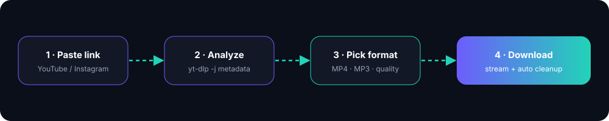
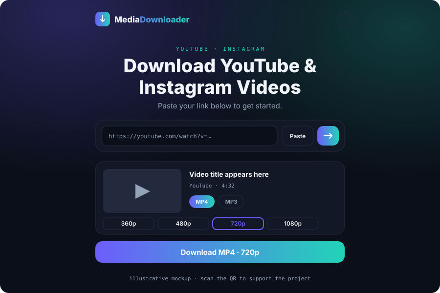
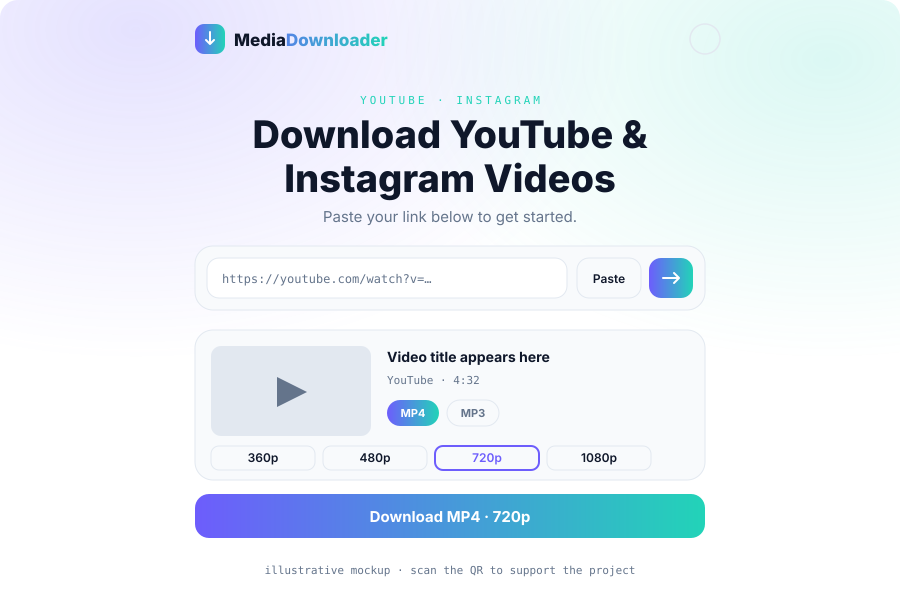
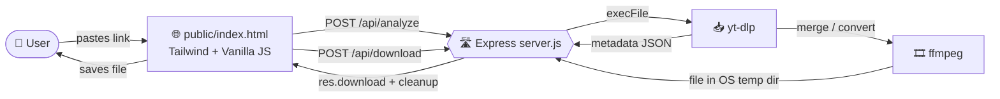
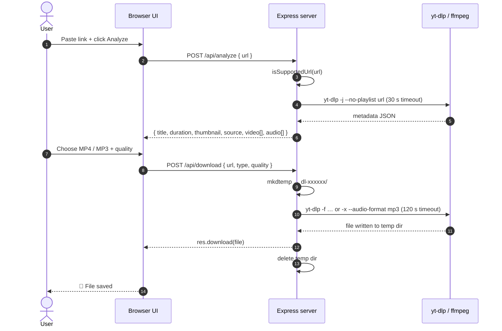

<div align="center">




<br/>

<a href="https://github.com/Syed-Muhammad-Tayyab/yt-downloader">
  
</a>

<br/><br/>


[](LICENSE)
[](https://github.com/Syed-Muhammad-Tayyab/yt-downloader/actions)
[](https://github.com/Syed-Muhammad-Tayyab/yt-downloader/stargazers)
[](https://github.com/Syed-Muhammad-Tayyab/yt-downloader/network/members)
[](https://github.com/Syed-Muhammad-Tayyab/yt-downloader/issues)
[](https://github.com/Syed-Muhammad-Tayyab/yt-downloader/commits/main)
[](CONTRIBUTING.md)

<br/>

**[✨ Features](#-features)** &nbsp;•&nbsp;
**[🖼️ Preview](#️-preview)** &nbsp;•&nbsp;
**[🧱 Tech Stack](#-tech-stack)** &nbsp;•&nbsp;
**[⚙️ How It Works](#️-how-it-works)** &nbsp;•&nbsp;
**[🔌 API](#-api-reference)** &nbsp;•&nbsp;
**[🚀 Getting Started](#-getting-started)** &nbsp;•&nbsp;
**[☁️ Deployment](#️-deployment)** &nbsp;•&nbsp;
**[🗺️ Roadmap](#️-roadmap)**

</div>


<details>
<summary><b>📑 Table of Contents</b> (click to expand)</summary>

<br/>

1. [About the Project](#-about-the-project)
2. [Features](#-features)
3. [Preview](#️-preview)
4. [Tech Stack](#-tech-stack)
5. [How It Works](#️-how-it-works)
6. [API Reference](#-api-reference)
7. [Quality Map](#-quality-map)
8. [Project Structure](#-project-structure)
9. [Getting Started](#-getting-started)
10. [Configuration](#️-configuration)
11. [Deployment](#️-deployment)
12. [Design System](#-design-system)
13. [Security & Privacy](#-security--privacy)
14. [Roadmap](#️-roadmap)
15. [FAQ](#-faq)
16. [Contributing](#-contributing)
17. [Legal Notice](#️-legal-notice)
18. [License & Credits](#-license--credits)
19. [Developer](#-developer)

</details>


## 🎯 About the Project

**Media Downloader** is a clean, single-page web app that turns a pasted **YouTube** or **Instagram** link into a downloadable file. You paste a link, the app reads the **title, thumbnail and duration**, and you choose to save it as **MP4 video (360p – 1080p)** or **MP3 audio (128 / 320 kbps)**.

Under the hood, a small **Node.js + Express** server shells out to **[`yt-dlp`](https://github.com/yt-dlp/yt-dlp)** and **[`ffmpeg`](https://ffmpeg.org)**, downloads the requested format to a temporary folder, streams the file to the browser, and then deletes it. The frontend is a single static HTML file styled with **Tailwind CSS (CDN)** — no build step, no bundler, no framework.

> 💡 **Why it's nice to work with:** one dependency (`express`), one server file, one HTML page, one Dockerfile. You can read the whole codebase in ten minutes.




## ✨ Features

| | Feature | Details |
|:-:|---|---|
| 🔗 | **Paste & analyze** | Paste a YouTube or Instagram link (a one-click **Paste** button reads your clipboard) and instantly see title, thumbnail, duration and source |
| 🎬 | **MP4 video** | Choose **360p · 480p · 720p · 1080p** — the quality is applied as a height ceiling via `yt-dlp` format selectors |
| 🎧 | **MP3 audio** | Extract audio at **128 kbps** or **320 kbps** using `ffmpeg` |
| 🌗 | **Light / dark theme** | One-click theme toggle with a violet → teal aurora background |
| 📱 | **Responsive UI** | Mobile-first layout, keyboard-focus outlines, `prefers-reduced-motion` support |
| 🧹 | **Auto cleanup** | Every download lives in a throw-away temp directory that is removed as soon as the response finishes |
| 🚫 | **No playlists** | `--no-playlist` keeps each request to a single item |
| ⚠️ | **Friendly errors** | Clear messages for invalid links, private/deleted media and failed downloads |
| 🐳 | **Docker-ready** | The included `Dockerfile` installs Node, Python, ffmpeg and yt-dlp for you |
| ❤️ | **Support card** | A built-in "Support This Project" QR card (swap `public/qr.jpg` with your own) |


## 🖼️ Preview

<div align="center">

<table>
<tr>
<td align="center"><b>🌙 Dark theme</b></td>
<td align="center"><b>☀️ Light theme</b></td>
</tr>
<tr>
<td></td>
<td></td>
</tr>
</table>

<sub>Illustrative mockups of the interface. Replace them with real screenshots in <code>docs/assets/</code> whenever you like.</sub>

<br/><br/>

**❤️ Support card shipped with the app**


</div>


## 🧱 Tech Stack

| Layer | Technology | Purpose |
|---|---|---|
| 🖥️ **Runtime** |  | Runs the server (`engines.node >= 18`, Docker image uses Node 20) |
| 🛣️ **Server** |  | JSON API + static file hosting |
| 📥 **Downloader** |  | Reads metadata and fetches media |
| 🎞️ **Media tools** |  | Merges streams and converts to MP3 |
| 🎨 **Styling** |  | Utility-first CSS via CDN |
| ✍️ **Frontend** |   | Single static page, `fetch()` to the API |
| 🔤 **Fonts** | Inter · JetBrains Mono | Google Fonts |
| 🐳 **Packaging** |  | One-file deployment image |
| 🤖 **CI** |  | Syntax check on Node 18/20/22 + Docker build |


## ⚙️ How It Works

### 🧭 System overview



### 🔁 Request sequence



<details>
<summary><b>🔍 Step-by-step breakdown</b> (click to expand)</summary>

<br/>

1. **Validate** — the server checks that the URL looks like a YouTube / Instagram link.
2. **Analyze** — `yt-dlp -j --no-warnings --no-playlist <url>` returns metadata as JSON; the server formats the duration (`m:ss` or `h:mm:ss`) and replies with title, thumbnail, source and the list of qualities the UI offers.
3. **Pick** — the user selects **MP4** (360p/480p/720p/1080p) or **MP3** (128/320 kbps).
4. **Download** — the server creates a random temp directory, runs `yt-dlp` with the matching arguments (`-f best[height<=N] --merge-output-format mp4` for video, `-x --audio-format mp3 --audio-quality …` for audio) and waits up to 120 seconds.
5. **Stream & clean up** — the produced file is sent with `res.download()`, and the temp directory is removed whether the transfer succeeds or fails.

</details>


## 🔌 API Reference

Base URL: `http://localhost:3000`

### `POST /api/analyze`

Reads a link and returns what the UI needs to render the result card.

```bash
curl -X POST http://localhost:3000/api/analyze \
  -H "Content-Type: application/json" \
  -d '{"url":"https://www.youtube.com/watch?v=VIDEO_ID"}'
```

<details>
<summary><b>📤 Example response</b></summary>

```json
{
  "title": "Video title",
  "duration": "4:32",
  "thumbnail": "https://…/thumbnail.jpg",
  "source": "YouTube",
  "video": [
    { "quality": "360p" },
    { "quality": "480p" },
    { "quality": "720p" },
    { "quality": "1080p" }
  ],
  "audio": [
    { "quality": "128kbps" },
    { "quality": "320kbps" }
  ]
}
```

</details>

### `POST /api/download`

Downloads the requested format server-side, then streams the file back as an attachment.

```bash
curl -X POST http://localhost:3000/api/download \
  -H "Content-Type: application/json" \
  -d '{"url":"https://www.youtube.com/watch?v=VIDEO_ID","type":"video","quality":"720p"}' \
  -OJ
```

| Field | Type | Values |
|---|---|---|
| `url` | string | YouTube or Instagram link |
| `type` | string | `video` &#124; `audio` |
| `quality` | string | video: `360p` `480p` `720p` `1080p` · audio: `128kbps` `320kbps` |

### ⚠️ Error responses

| Status | When | Message |
|:-:|---|---|
| `400` | Missing / unsupported URL | `Enter a valid YouTube or Instagram link.` |
| `400` | `type` is not `video` or `audio` | `Unknown download type.` |
| `502` | `yt-dlp` could not read the link | `Could not read that link. It may be private, deleted, or unsupported.` |
| `502` | Metadata was not valid JSON | `Unexpected response while analyzing this link.` |
| `502` | Download failed | `Download failed. Try a different format or link.` |
| `502` | No output file produced | `No file was produced for that format.` |


## 🎚️ Quality Map

How the UI labels translate into `yt-dlp` arguments:

| Type | UI label | `yt-dlp` argument |
|:-:|:-:|---|
| 🎬 Video | `360p` | `-f "best[height<=360]"` |
| 🎬 Video | `480p` | `-f "best[height<=480]"` |
| 🎬 Video | `720p` | `-f "best[height<=720]"` |
| 🎬 Video | `1080p` | `-f "best[height<=1080]"` |
| 🎧 Audio | `128kbps` | `-x --audio-format mp3 --audio-quality 128K` |
| 🎧 Audio | `320kbps` | `-x --audio-format mp3 --audio-quality 320K` |

All video downloads also pass `--merge-output-format mp4 --no-warnings --no-playlist`.

> ℹ️ The video quality is a **ceiling**, not a guarantee — see the [FAQ](#-faq).


## 📁 Project Structure

```bash
📦 yt-downloader
├── 📂 .github
│   ├── 📂 ISSUE_TEMPLATE
│   │   ├── 🐛 bug_report.md
│   │   ├── ✨ feature_request.md
│   │   └── ⚙️ config.yml
│   ├── 📂 workflows
│   │   └── 🤖 ci.yml                 # Node 18/20/22 syntax check + Docker build
│   ├── 💖 FUNDING.yml
│   └── 📝 PULL_REQUEST_TEMPLATE.md
├── 📂 docs
│   └── 📂 assets                     # README graphics
│       ├── 🎨 banner.svg
│       ├── 🎨 divider.svg
│       ├── 🎨 footer.svg
│       ├── 🎨 pipeline.svg
│       ├── 🖼️ preview-dark.svg
│       └── 🖼️ preview-light.svg
├── 📂 public                         # Static frontend served by Express
│   ├── 🌐 index.html                 # UI: Tailwind CDN + vanilla JS
│   ├── 🖼️ qr.jpg                     # Support QR card image
│   └── 🖼️ qr.png.jpeg
├── 🟩 server.js                      # Express API: /api/analyze, /api/download
├── 📦 package.json                   # Single dependency: express
├── 🐳 Dockerfile                     # Node 20 + python3 + ffmpeg + yt-dlp
├── 🐳 docker-compose.yml
├── ☁️ render.yaml                    # Render Blueprint
├── 🔑 .env.example
├── 🚫 .gitignore
├── 🚫 .dockerignore
├── 🧹 .editorconfig
├── 🤝 CONTRIBUTING.md
├── 📜 CODE_OF_CONDUCT.md
├── 🔒 SECURITY.md
├── ⚖️ LICENSE
└── 📖 README.md
```


## 🚀 Getting Started

### ✅ Prerequisites

| Tool | Version | Needed for |
|---|---|---|
| [Node.js](https://nodejs.org) | 18 or newer (LTS recommended) | Running the server |
| [yt-dlp](https://github.com/yt-dlp/yt-dlp) | latest | Reading and downloading media |
| [ffmpeg](https://ffmpeg.org) | any recent | Merging and MP3 conversion |

> 🐳 Don't want to install anything? Skip to **[Docker](#-option-b--docker)**.

### 💻 Option A — Run locally

**1. Clone the repository**

```bash
git clone https://github.com/Syed-Muhammad-Tayyab/yt-downloader.git
cd yt-downloader
```

**2. Install `yt-dlp` and `ffmpeg`**

<details>
<summary><b>🍎 macOS</b></summary>

```bash
brew install yt-dlp ffmpeg
```

</details>

<details>
<summary><b>🪟 Windows</b></summary>

```powershell
winget install yt-dlp
winget install ffmpeg
```

</details>

<details>
<summary><b>🐧 Linux</b></summary>

```bash
sudo apt install ffmpeg
pip install yt-dlp
```

</details>

**3. Install dependencies and start**

```bash
npm install
npm start
```

**4. Open the app** → **http://localhost:3000** 🎉

### 🐳 Option B — Docker

```bash
docker build -t media-downloader .
docker run -p 3000:3000 media-downloader
```

### 🐙 Option C — Docker Compose

```bash
docker compose up --build
```


## ⚙️ Configuration

| Variable | Default | Description |
|---|---|---|
| `PORT` | `3000` | Port the Express server listens on |
| `YTDLP_PATH` | `yt-dlp` | Path to the `yt-dlp` binary if it is not on your `PATH` |

Copy `.env.example` to `.env` for reference. The server reads these from the process environment, so set them in your shell, Docker run command or hosting dashboard.


## ☁️ Deployment

The included `Dockerfile` installs everything the app needs, so any host that supports **"Deploy from Dockerfile"** works.

<details open>
<summary><b>🟣 Render (recommended, GitHub → Render)</b></summary>

<br/>

1. Push this repository to your GitHub account.
2. On [render.com](https://render.com) choose **New → Web Service** and connect the repository.
3. Set **Runtime** to **Docker** (Render detects the `Dockerfile`), or use **New → Blueprint** to apply `render.yaml`.
4. Click **Create Web Service** and wait for the build to finish.
5. Open the generated `*.onrender.com` URL.

</details>

<details>
<summary><b>🚆 Railway</b></summary>

<br/>

1. **New Project → Deploy from GitHub repo** and pick this repository.
2. Railway builds from the `Dockerfile` automatically.
3. Under **Settings → Networking**, generate a public domain.

</details>

<details>
<summary><b>🪁 Fly.io</b></summary>

<br/>

```bash
fly launch      # detects the Dockerfile
fly deploy
```

</details>

> ⚠️ Free tiers may sleep when idle, limit CPU/time per request, or restrict this kind of workload. Large downloads can hit the 120-second server timeout on slow hosts.


## 🎨 Design System

The UI uses a violet → teal palette on a deep-ink dark theme (values taken from the Tailwind config in `public/index.html`).

| Swatch | Token | Hex | Usage |
|:-:|---|---|---|
|  | `reel.violet` | `#6D5DFC` | Primary accent, gradient start, focus ring |
|  | `reel.teal` | `#22D3B8` | Secondary accent, gradient end |
|  | `reel.ink` | `#0B0F19` | Dark background |
|  | `reel.card` | `#131826` | Dark cards |
|  | `reel.line` | `#232A3D` | Dark borders |

**Typography:** `Inter` (UI) · `JetBrains Mono` (labels & code) &nbsp;|&nbsp; **Motion:** rise / pop / scan-line / pulse-glow, all disabled under `prefers-reduced-motion`.


## 🔐 Security & Privacy

| ✅ What the app does | |
|---|---|
| No accounts, database or analytics | Nothing about users or links is stored |
| Temp files only | Each download is written to a random `dl-xxxxxx` folder in the OS temp directory and deleted when the response ends (or fails) |
| No shell | `yt-dlp` is launched with `execFile` and an argument array, not through a shell string |
| Timeouts | 30 s for analysis, 120 s for downloads |

> ⚠️ **If you host this publicly**, treat it as an internet-facing service that runs a powerful downloader on your machine: add **rate limiting**, request-size and concurrency limits, and consider a stricter URL allow-list (see the [Roadmap](#️-roadmap)). Keep `yt-dlp` updated — sites change often and old versions stop working.


## 🗺️ Roadmap

- [x] Analyze YouTube & Instagram links (title, thumbnail, duration)
- [x] MP4 download at 360p / 480p / 720p / 1080p
- [x] MP3 download at 128 / 320 kbps
- [x] Light / dark theme
- [x] Docker image with all system dependencies
- [x] Automatic temp-file cleanup
- [ ] Stricter URL validation (parse with `new URL()`, allow-list hostnames, pass `--` before the URL)
- [ ] Per-IP rate limiting and a concurrency cap
- [ ] Better 1080p support via `bestvideo+bestaudio` merging
- [ ] Show only the qualities a video really offers
- [ ] Run the Docker container as a non-root user
- [ ] Download progress bar
- [ ] Health-check endpoint (`/healthz`)
- [ ] Automated tests

Have an idea? [Open a feature request](https://github.com/Syed-Muhammad-Tayyab/yt-downloader/issues/new?template=feature_request.md).


## ❓ FAQ

<details>
<summary><b>Why is my 1080p download lower quality?</b></summary>

<br/>

The video selector is `best[height<=1080]`, which picks the best **single-file** format at or below that height. Many platforms only provide higher resolutions as separate video and audio streams, so the result can be lower than requested. Switching to `bestvideo[height<=N]+bestaudio` (merged by `ffmpeg`) is on the roadmap.

</details>

<details>
<summary><b>Does it support playlists?</b></summary>

<br/>

No. `--no-playlist` is always passed, so only the single item is processed.

</details>

<details>
<summary><b>Why does it say "Could not read that link"?</b></summary>

<br/>

The media may be private, age-restricted, deleted, region-locked, or the platform changed something. Update `yt-dlp` (or rebuild the Docker image) and try again.

</details>

<details>
<summary><b>Where are downloaded files stored?</b></summary>

<br/>

Only temporarily, in the server's OS temp directory, and they are deleted right after being sent to your browser.

</details>

<details>
<summary><b>How do I change the support QR code?</b></summary>

<br/>

Replace `public/qr.jpg` with your own image (keep the same file name).

</details>

<details>
<summary><b>Can I use another yt-dlp location?</b></summary>

<br/>

Yes — set the `YTDLP_PATH` environment variable to the binary's full path.

</details>


## 🤝 Contributing

Contributions, issues and feature requests are welcome!

1. 🍴 **Fork** the project
2. 🌱 Create a branch: `git checkout -b feat/amazing-feature`
3. ✅ Run `node --check server.js`
4. 💾 Commit: `git commit -m "feat: add amazing feature"`
5. 📤 Push: `git push origin feat/amazing-feature`
6. 🔁 Open a **Pull Request**

Please read [CONTRIBUTING.md](CONTRIBUTING.md) and the [Code of Conduct](CODE_OF_CONDUCT.md) first. Security problems? See [SECURITY.md](SECURITY.md).


## ⚖️ Legal Notice

Downloading from YouTube or Instagram this way can conflict with their **Terms of Service**, and downloading copyrighted content without permission may be illegal in your country. This project is provided for **educational purposes and for downloading content you own or have permission to save**. You are responsible for how you use it — review the rules that apply to you before making a deployment public.


## 📜 License & Credits

Distributed under the **MIT License** — see [`LICENSE`](LICENSE) for details.

**Built with**

- [yt-dlp](https://github.com/yt-dlp/yt-dlp) — the downloader doing the heavy lifting
- [FFmpeg](https://ffmpeg.org) — merging and audio conversion
- [Express](https://expressjs.com) — the web server
- [Tailwind CSS](https://tailwindcss.com) — styling
- [Shields.io](https://shields.io), [Capsule Render](https://github.com/kyechan99/capsule-render) & [readme-typing-svg](https://github.com/DenverCoder1/readme-typing-svg) — README decoration


## 👨‍💻 Developer

<div align="center">

### **Syed Muhammad Tayyab**

*BSCS student · Information Security · Full-stack web developer*

[](https://github.com/Syed-Muhammad-Tayyab)

<br/>

⭐ **If you found this project useful, please give it a star!** ⭐

<br/>


</div>
